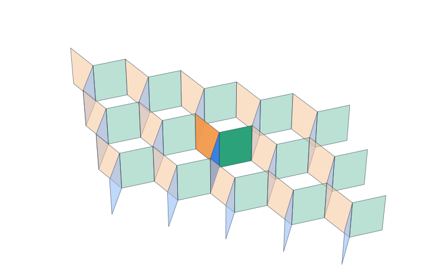

# RVE Studio 1.0 — User Guide

RVE Studio computes the effective stiffness of laminated-composite cellular cores (honeycombs and any other periodic
wall network) from a periodic representative volume element (RVE), rates how far the wall model can be trusted,
validates it against periodic shell finite elements with a mesh-convergence verdict, and generates and screens
large design databases. This guide explains every workspace step by step. The equations and the modelling
guidance are in the [Theory and Modelling Guidance](THEORY.md).



---

## Contents

1. [Installation and start-up](#1-installation-and-start-up)
2. [A first design in five minutes](#2-a-first-design-in-five-minutes)
3. [The workspaces](#3-the-workspaces)
4. [Single RVE Designer](#4-single-rve-designer)
5. [Laminate Tools](#5-laminate-tools)
6. [Material Library](#6-material-library)
7. [Geometry Library and plug-ins](#7-geometry-library-and-plug-ins)
8. [Generate DB](#8-generate-db)
9. [Large Batch Analysis](#9-large-batch-analysis)
10. [Results Explorer](#10-results-explorer)
11. [Benchmark Designs](#11-benchmark-designs)
12. [FE Design & Validation](#12-fe-design--validation)
13. [Command line](#13-command-line)
14. [Python API](#14-python-api)
15. [Files and units](#15-files-and-units)
16. [Performance](#16-performance)
17. [Troubleshooting and FAQ](#17-troubleshooting-and-faq)

---

## 1. Installation and start-up

RVE Studio needs Python 3.10 or newer. The numerical core uses NumPy, SciPy, pandas, Matplotlib and openpyxl; the
graphical interface uses PySide6 (Qt 6).

**Windows (recommended for most users).** Double-click `install_windows.bat` once: it creates a local virtual
environment `.venv` and installs everything. Start RVE Studio with `START_RVE_STUDIO.bat`. `diagnose_startup.bat` reports
what is missing if the window does not open.

**Any platform, from the source folder.**

```bash
python -m venv .venv
source .venv/bin/activate            # Windows: .venv\Scripts\activate
pip install -e ".[gui]"              # numerical core + GUI; use "." for the core only
rvestudio-gui                        # or: python launch_rve_studio.py
```

**Command line and Python only** (no Qt needed): `pip install .` then `rvestudio --help` or `import rvestudio`.

**Windows installer (recommended for Windows users; no Python needed).** Run
`RVE_Studio_Setup_<version>.exe` (attached to every release). The installer

* installs for the current user without administrator rights, or for all users if you choose so;
* adds *RVE Studio*, *RVE Studio User Guide*, *RVE Studio Theory Guide* and *Uninstall RVE Studio* to the Start
  menu, and optionally a desktop shortcut;
* optionally associates `.rvejson` project files, so a double-click opens the project in the Single RVE Designer;
* is removed with *Uninstall RVE Studio* or *Settings → Apps*. Your own libraries in `%USERPROFILE%\.rve_studio_v1`
  (materials, geometries, layups, plug-ins) are kept.

Windows may show a SmartScreen warning for an unsigned installer: choose *More info → Run anyway*.

**Building the installer.** On a Windows PC with 64-bit Python 3.10+ and Inno Setup 6, double-click
`build_windows_installer.bat`. It builds the application with PyInstaller (`RVE_Studio.spec`) in
`dist\RVE_Studio\RVE_Studio.exe` and the installer `dist\RVE_Studio_Setup_<version>.exe` (`installer\RVE_Studio.iss`).
Each tagged GitHub release builds and attaches the installer automatically.

**Libraries.** In a source checkout the editable libraries are `data/` (materials, geometries, layups) and
`plugins/` (geometry plug-ins). An installed package copies the defaults to `~/.rve_studio_v1/` on first use, so nothing is
ever written into the Python installation.

## 2. A first design in five minutes

1. Start RVE Studio. The **Dashboard** opens. Press **Open RVE designer** (or *Start designing an RVE*).
2. The designer opens on the **RVE Sketch & Geometry** tab with benchmark design 1 loaded (regular hexagon,
   50 mm walls, core height 150 mm). Choose another under *Load example configuration*, load a family from the
   Geometry Library, or draw your own (Section 4.1).
3. Open **Wall laminates** and edit the ply stacks (material, angle, thickness). Each wall refers to a stack.
4. Open **Solver**. Keep *Euler–Bernoulli* + *Cylindrical* to reproduce the original model, or choose
   *Timoshenko* + *Twist-corrected* for the most accurate wall model (Theory, Section 10). Press **Run**.
5. Open **Results**. Read Cᴴ, S, the Q matrix, the engineering constants, the RVE mass and density, and the
   **reliability** line: *reliable*, *use with care* or *outside the verified range*, with the reason.
6. *File → Save RVE project…* writes a `.rvejson` file you can reopen, solve from the command line, or validate in
   **FE Design & Validation**.

## 3. The workspaces

The navigation bar on the left holds twelve workspaces, each with a coloured badge. Every page except the
Dashboard scrolls when the window is small; the Dashboard always fits the window.

| Workspace | Purpose |
|---|---|
| **Dashboard** | Overview; library counts; one tile per main task (RVE designer, laminates, FE design & validation, databases, multi-objective optimisation, wall buckling) |
| **Single RVE Designer** | Draw or load an RVE, assign wall laminates, choose the wall model, solve, recover wall loads, screen buckling |
| **Laminate Tools** | A, B, D, S_eq, lamination parameters, invariants, bend–twist ratio of one stack |
| **Material Library** | Ply materials (E1, E2, G12, ν12, Gth, density, cost) |
| **Geometry Library** | Parametric families (HEX, SQUARE, MIXED, TRI, user plug-ins) with diagrams |
| **Generate DB** | Latin-hypercube parametric databases with a chosen wall model |
| **Large Batch Analysis** | Solve databases in parallel, optional buckling |
| **Results Explorer** | Ashby plots, anisotropy, E(θ), correlation, sensitivity, ranking, Pareto and robust optimisation |
| **Benchmark Designs** | The 14 benchmark designs solved with any wall model, against the reference values |
| **FE Design & Validation** | Periodic shell FE (built-in or Abaqus) of any design, with mesh-convergence verdicts |
| **Help** (F1) | Opens this User Guide and the Theory Guide (PDF); also in the Help menu |
| **About / Workflow** | Version, source paper, licence and citation |

Dashboard tiles always open the right place: *Open RVE designer* opens the design tab, *Open wall buckling* the
Wall buckling tab.

## 4. Single RVE Designer

### 4.1 RVE Sketch & Geometry

The RVE is defined twice, kept in step: an interactive drawing and the numerical **Node**, **Wall** and
**Explicit periodic pairs** tables. The tables open in their own resizable window (*Node table…*, *Wall
table…*, *Periodic pairs…* buttons); edits update the drawing immediately, and the window can stay open beside it.

**Sketch tools.**

| Tool | Action |
|---|---|
| Select / move | drag a node; connected walls and all derived geometry follow |
| Node | click to place a node (grid spacing and snap configurable) |
| Wall | click two nodes to join them |
| Delete | click a node or wall (attached walls are removed, nodes renumbered) |
| Set a1 / Set a2 | click two nodes: the vector between them becomes a lattice vector |
| Horizontal / Vertical | align the selected wall |
| Set length… | move the second node along the wall to a given length |
| Fit drawing, Show dimensions, Wall direction I → J | view aids |
| Undo / Redo | reverse or repeat drawing edits |

**Wall table.** `ID | Node I | Node J | Weight | Stack ID` plus the computed *Length*, *Angle of 1̄* and *Wall
group*. **Node I → Node J sets the wall's local 1̄ axis**, from which ply angles are measured: reversing a wall
changes the results of off-axis and unsymmetric stacks (Theory, Section 4). *Reverse I ↔ J* flips the selected
walls. *Wall editor…* opens a large window with the table beside a drawing of every wall, its I → J arrow and its
normal. *Weight* is 1 for interior walls and ½ for a wall lying on the RVE boundary and shared with its image.

**Periodic cell.** Enter $\mathbf a_1$, $\mathbf a_2$ and the core height $h$. RVE Studio previews the periodic images;
*Populate detected periodic pairs* writes them as explicit rows `Master, Slave, n1, n2`
($\mathbf x_{slave} - \mathbf x_{master} = n_1\mathbf a_1 + n_2\mathbf a_2$) when an unusual RVE needs them.

**Geometry inspector.** Number of nodes and walls, extents, lattice lengths, RVE area, total and weighted wall
length, node coordination, periodic-pair candidates, and the characteristic cell dimensions p, q, r. Recognised
families (HEX, SQUARE, MIXED, TRI) are reported with a match confidence and the walls that set each parameter.
*Validate geometry* checks for missing or invalid references, zero-length or duplicate walls, coincident nodes,
disconnected networks and dependent lattice vectors; errors block the solve.

**Starting points.** *Load example configuration* (benchmark designs 1–14), *Existing geometry* (any library
family at chosen parameter values, *Load selected geometry*), or *New sketch*.

### 4.2 Wall laminates

The ply table `Stack ID | Ply | Material | Angle [deg] | Thickness`. Walls refer to a Stack ID, so different walls
can have different materials, angles and thicknesses; hybrid stacks are supported ply by ply. *Auto wall groups*
groups walls by geometry parameter (or direction); *Apply stack to group* copies the selected wall's stack to its
group; *Unique stack for each wall* gives every wall its own copy.

### 4.3 Solver

The **Wall model** box holds the two choices that define the wall:

* **Wall beam** — *Euler–Bernoulli (default)* or *Timoshenko (with wall shear flexibility)*.
* **Bending option** — *Cylindrical*, *Twist-corrected*, *Anisotropic strip* or *Free moment*
  (Theory, Section 5).

When *Twist-corrected* is selected the box **Twist-corrected wall: η = (a + b ψ²) λⁿ** becomes active. It shows the
calibrated coefficients a = 2.0, b = 2.15, n = 0.73; edit them to use your own calibration, and press *Restore
calibrated values* to go back. Designs solved with edited coefficients are rated at best *use with care*.

| Goal | Wall beam | Bending option |
|---|---|---|
| Reproduce the source paper | Euler–Bernoulli | Cylindrical |
| Most accurate for any stacking sequence | Timoshenko | Twist-corrected |
| Upper and lower bounds on wall bending | any | Cylindrical / Free moment |

*Periodic tolerance* (default 1e-8) controls pair detection; *Anchor node* is the node whose translations are
fixed. Press **Run**. Geometry checks run first; the status line names the wall model and the reliability.

### 4.4 Results

| Tab | Content |
|---|---|
| Cᴴ [MPa] | full 6×6 homogenised stiffness, Voigt order 11, 22, 33, 23, 13, 12 |
| S [1/MPa] | compliance |
| In-plane Q, Shear Q | shell matrix ($\sigma_{33}=0$): Q11, Q22, Q12, Q66; Q44 (1–3), Q55 (2–3) |
| Engineering properties | E1, E2, E3, G12, G13, G23, all νij |
| RVE / physical | area, volume, relative density, mass, average density, cost |

**Reliability.** Below the results RVE Studio states, for the in-plane and the out-of-plane properties, whether the wall
model is *reliable*, *use with care* or *outside the verified range*, and lists every wall laminate with its
bend–twist ratio ψ, twist length λ, twist release η, bend–twist index Π, χ_B and β, and a note such as
"bend–twist index Π = 0.036: E1, E2, G12 and ν13 are over-predicted by about 4 %; the twist-corrected option extends
the range". The limits are in Theory, Section 9. When the rating is not *reliable*, change the wall model as the
note suggests or validate the design in **FE Design & Validation**.

### 4.5 Wall load recovery

Choose stress or strain control and enter the six components in the order 11, 22, 33, 23, 13, 12 (compression
negative). *Recover wall loads* re-solves the RVE and lists each wall's local resultants $\bar N_{11}$,
$\bar N_{33}$, $\bar N_{13}$ (N/mm), its membrane strains and geometry. The validation table should show PASS for
equilibrium, periodic compatibility, macro/micro energy, element energy, nodal-force and ε33-conjugate-force
checks. *Export wall loads CSV* saves the table.

### 4.6 Wall buckling

*Evaluate buckling from recovered wall loads* (or *Recover current loads + evaluate*) treats every wall as a
simply supported laminated plate $L \times h$ under its recovered resultants. Set the modal truncation `m max`,
`n max` (default 8 × 8, checked against 6 × 6), the required factor and the ABD condensation for unsymmetric walls.
The table gives $\lambda_{cr}$ of every wall, the critical wall, the dominant mode, the convergence indicator and
pass/fail. *Export buckling CSV* saves it.

## 5. Laminate Tools

Enter a stack and press *Calculate laminate*. RVE Studio reports A, B, D, the neutral-plane D and offset d, S_eq and the
shear correction factor, the lamination parameters ξᴬ and ξᴰ, the five invariants of every constituent, the
cylindrical, free-moment and twist-corrected strip bending stiffnesses, and the bend–twist ratio ψ. These are the
same functions the RVE solver uses.

## 6. Material Library

An editable table of `data/materials.json`: *Name, E1, E2, G12, ν12, Gth, Density kg/m³, Cost / kg, Source,
Active*. Gth (through-thickness shear modulus) defaults to G12 but should be given explicitly. Density is needed
for mass and specific properties; cost (user-defined; the bundled values are relative placeholders) for cost
outputs. Only *Active* materials are sampled by Generate DB. Press *Save* after editing.

## 7. Geometry Library and plug-ins

Built-in families: **HEX** (unequal-wall hexagon, L1, L2), **SQUARE** (Lx, Ly), **MIXED** (rhombus–triangle,
Lh, R) and **TRI** (Lh, R). Each has named parameters with sampling ranges. Selecting a row draws the family at its
reference values with every parameter's walls coloured and dimensioned, the wall numbers, neighbouring cells, the
unit cell and the lattice vectors; *Parameter guide* shows all families.

**Your own family.** Draw it in the designer, then press *Create from current sketch*: the Geometry Definition
Wizard recognises a built-in topology or creates a width/height-parametric plug-in from the normalised sketch. The
new family appears at once under *Existing geometry*. Advanced users can write a plug-in by hand: a `.py` file in
`plugins/` with `GEOMETRY_ID` and `generate(params) → Geometry` (nodes, connectivity, a1, a2, wall_groups,
wall_weights); see `plugins/custom_geometry_template.py`. Plug-ins are re-read only when a file changes.

## 8. Generate DB

1. Set *Cases*, *Seed* and the target relative density range ρ\* min–max, and the output file (CSV, XLSX or
   Parquet).
2. In **Wall model written to every case** choose the wall beam, the bending option and, for *Twist-corrected*,
   the coefficients a, b, n.
3. Press *Generate DB*.

Every active material, geometry and layup is sampled; geometry parameters and ρ\* are Latin-hypercube sampled;
each wall gets its own thickness, scaled so that every case meets its target ρ\* exactly. Each row carries
`SolverType`, `StripMode`, `WallShear` and `TwistA/B/N`, so the batch solves it with the chosen wall model. Per-wall
overrides `W1Material`, `W1LayupID`, `W1LayupAngles`, … may be added to the table by hand.

## 9. Large Batch Analysis

Choose the input database and the output file, the number of *Workers* (processes) and an optional *Case limit*.
Start with 1 worker and 20 cases to check the set-up, then use all cores. Failed cases get `Status = FAILED` and an
error message; the others continue. Every output row contains the inputs, Cᴴ (21 terms), the Q matrix, the
engineering constants, mass, density and cost, and the reliability columns `PsiMax`, `BendTwistIndexMax`, `ChiBMax`,
`BetaMax`, `ReliabilityInPlane`, `ReliabilityOutOfPlane`.

**Batch buckling** (optional): enter one macroscopic stress state, the modal truncation and the required factor;
each row then gets `BucklingLambdaMin`, the critical wall and mode, utilisation and convergence.

## 10. Results Explorer

Open a batch output (*Open results*); for an older file without design columns use *Attach input database*
(joined by CaseID).

| Tab | Use |
|---|---|
| Ashby / scaling | any X–Y pair, log axes, colour by category, min-X/max-Y Pareto front, power-law fit $y = C\rho^n$ |
| Anisotropy | geometric aspect ratio against E1/E2, Q11/Q22, shear anisotropy, Q12 coupling |
| Directional E(θ) | in-plane Young's modulus in every direction for one case |
| Correlation | correlation matrix of the numeric columns |
| Sensitivity | Pearson, Spearman and standardised regression for numbers; η² for categories |
| Top designs | rank by any property or derived efficiency |
| Multi-objective optimisation | objectives (maximise, minimise, target, weight), constraints, Pareto set and weighted compromise; robust kσ screening; manufacturing rules (thickness, ratios, ply counts, balanced/symmetric, allowed angles, minimum buckling factor) |

*Export derived data*, *Export optimisation results*, *Save plot* (PNG 300 dpi, SVG, PDF) and *Save Pareto plot*
save the results. Filtering on `ReliabilityInPlane = reliable` keeps only designs inside the verified range.

## 11. Benchmark Designs

The 14 wall configurations of the source paper (regular hexagon, 50 mm walls, h = 150 mm, E-glass/epoxy and
boron/epoxy, five plies) with six shell stiffnesses each — 84 values.

1. Choose the **wall model**: wall beam, bending option and (for *Twist-corrected*) the coefficients.
2. Set the tolerance (default ±1 %) and press **Solve the 14 benchmark designs**.
3. The banner states how many values lie within the tolerance of the reference values and the largest difference;
   the table lists every value (*Design, Stiffness, Calculated, Reference, Difference %, Status*). Filter by design
   or stiffness, or show only the values that differ. *Export CSV…* saves the table.

With the default Euler–Bernoulli + Cylindrical walls every value is within 0.3 % (all 84 *WITHIN*). With other wall
models the differences show the effect of wall shear flexibility and twist release on each stiffness; judge
those models against shell FE in **FE Design & Validation**.

## 12. FE Design & Validation

Validates the analytical model of any design against periodic shell FE. Every FE value is compared with the
analytical value of the same design.

### 12.1 Design the FE model

In box **1 — Design the FE model**:

* **Designs:** *Current design* (the design open in the RVE designer), *Project files…* (saved `.rvejson`), or
  *Benchmarks* (e.g. `1-14` or `1,7,9`).
* **FE RVE:** select a design and press **Define FE RVE…** to keep the automatic FE RVE, choose n₁ × n₂ periodic
  cells, or drag a rectangle over the replicated design (rounded to whole cells, centred on the geometry where
  possible). *Automatic* resets it. PBC results do not depend on this choice; DBC results do.
* **Meshes:** element sizes in mm. `10` gives a quick look; **three sizes halving each time** (e.g. `10, 5, 2.5`)
  give the mesh-convergence verdict (Section 12.3).
* **Models:** *PBC* (full C, Q and engineering constants from strain energy) and/or *DBC* (shell terms with U3 free,
  3D terms with U3 = 0).
* **Study folder:** everything — designs, decks, results, report — is kept there and can be reopened later.

### 12.2 Validate

* **2 — Validate now (built-in shell FE):** no licence; seconds per design and mesh (0.4 s at 10 mm, 0.8 s at
  5 mm, 4.5 s at 2.5 mm for benchmark design 1). Meshes finer than 2.5 mm are skipped in the GUI on the
  full-height RVE.
* **3 — Validate with Abaqus:** enter the Abaqus command (*Detect* finds it, *Test* checks it answers) and CPUs per
  job, then *Run with Abaqus*. Jobs run one at a time; *Stop after current job* pauses safely and *Run with Abaqus*
  resumes. *Retry failed jobs* re-runs failures. *Scripts for another machine…* writes `run_all_jobs.bat/.sh` that
  need no Python; copy the folder back and press *Reload results*.

### 12.3 Read the results — and decide whether the mesh is converged

Choose the design under *Project*. Tabs: **Results** (findings in plain language; *Stiffness matrices* — C 6×6
and Q 5×5 as analytical | FE | difference; *C, Q and engineering constants*; *DBC terms*), **Charts**, **FE RVE**,
**Deformed shapes**, **Abaqus jobs** and **Log**. Differences are green (≤ 1 %), amber (≤ 5 %) or red (> 5 %).

With three meshes every FE term gets a **mesh verdict**:

| Verdict | Meaning | Action |
|---|---|---|
| converged | GCI of the finest mesh ≤ 1 %, observed order 0.5–4, asymptotic ratio within 1 ± 0.15 (or meshes agree to 0.01 %) | use the extrapolated FE value |
| refine (GCI) | converging properly but GCI > 1 % | add a mesh half the finest size |
| refine (not asymptotic) | the coarse mesh is outside the asymptotic range | drop the coarsest mesh, add a finer one |
| converged / refine (oscillating) | non-monotone; judged on the two finest meshes | refine if they differ by > 1 % |
| refine (diverging) | differences grow | check the model |

Only compare the analytical model with **converged** FE terms. Out-of-plane terms converge on any mesh; Q66,
C1212, G12, E1 and E2 converge slowly, especially for bend–twist coupled walls. A thin RVE (lower core height) does
not change the PBC result and makes 1.25 and 0.625 mm meshes affordable. The criteria are explained in Theory,
Section 13.

**Open report** opens `FE_STUDY_REPORT.html` (one self-contained file); **Open Excel** opens
`FE_STUDY_RESULTS.xlsx` (C matrix, Q matrix, engineering constants, DBC terms, convergence).

## 13. Command line

`rvestudio` (or `python -m rvestudio.cli`) runs everything without the GUI.

```bash
rvestudio --version
rvestudio single --config 7 --json                       # one benchmark design, JSON summary with reliability
rvestudio solve-project my_core.rvejson --full --output my_core.json
rvestudio benchmark                                      # default wall model, 84 values vs reference
rvestudio benchmark --wall-beam timoshenko --bending twist-corrected --csv bench.csv
rvestudio benchmark --bending twist-corrected --twist 2.0 2.15 0.73
rvestudio generate-db cases.csv --cases 5000 --seed 1 --wall-beam timoshenko --bending twist-corrected
rvestudio batch cases.csv results.csv --workers 8
rvestudio batch cases.csv results.csv --workers 8 --buckling --buckling-stress -1 -1 0 0 0 0.25
rvestudio fe check --root Study1 --project my_core.rvejson --meshes 10 5 2.5
rvestudio fe check --root Bench --paper-configs 1-14 --models pbc
rvestudio fe run   --root Bench --abaqus-command abaqus --cpus 4
rvestudio fe status --root Bench ; rvestudio fe report --root Bench ; rvestudio fe doctor
```

`--bending` takes `cylindrical`, `twist-corrected`, `anisotropic-strip` or `free-moment`; `--wall-beam` takes
`euler-bernoulli` or `timoshenko`.

## 14. Python API

```python
from rvestudio.api import solve, solve_example, solve_project, summary, benchmark
from rvestudio.models import Material, Ply, Laminate, Element, RVEModel
import numpy as np

# 1. a benchmark design
res = solve_example(config=1)
print(summary(res)["engineering_constants"], summary(res)["reliability"]["level"])

# 2. your own RVE: a regular hexagon with 50 mm walls
mat = {"Glass": Material("Glass", E1=39000, E2=8600, G12=3800, nu12=0.28, Gth=3800, density_kg_m3=2000)}
lam = Laminate([Ply("Glass", a, 0.4) for a in (45, -45, 0, -45, 45)])
L = 50.0; c = np.cos(np.pi / 6) * L
nodes = np.array([[0, 0], [2 * c, 0], [c, 1.5 * L], [c, 0.5 * L]])
walls = [Element(0, 3, 0), Element(1, 3, 0), Element(2, 3, 0)]
model = RVEModel(nodes, walls, a1=np.array([2 * c, 0]), a2=np.array([c, 1.5 * L]), height=150.0,
                 wall_element_type="anisotropicStrip", strip_bending_mode="twistRelease",
                 wall_shear="timoshenko")          # twist_release=(a, b, n) to override the calibration
res = solve(model, mat, [lam])
print(res.props.E1, res.props.G12, summary(res)["reliability"]["in_plane"])

# 3. benchmark with any wall model
out = benchmark(tolerance_pct=1.0, wall_shear="timoshenko", bending="twist-corrected")
print(out["within_tolerance"], out["max_abs_paper_pct"])
```

Wall model in `RVEModel`: `wall_element_type="paper"` (Cylindrical) or `"anisotropicStrip"` with
`strip_bending_mode` = `"cylindrical"` (Anisotropic strip), `"freeMoment"` or `"twistRelease"` (Twist-corrected);
`wall_shear="euler-bernoulli"` or `"timoshenko"`. Full reference: [API_REFERENCE.md](API_REFERENCE.md).

## 15. Files and units

| File | Content |
|---|---|
| `.rvejson` | project: nodes, lattice vectors, height, walls, stacks, materials, wall model, twist coefficients, FE RVE |
| `data/materials.json`, `geometries.json`, `layups.json` | libraries |
| `plugins/*.py` | geometry plug-ins |
| database CSV/XLSX/Parquet | one row per case (inputs) or per solved case (outputs) |
| study folder | `study.json`, decks, results, `FE_STUDY_REPORT.html`, `FE_STUDY_RESULTS.xlsx` |

Use one consistent unit system; the libraries are in MPa and mm. Density is kg/m³ and is converted with the model
length unit. Projects saved by the development builds (1.x) open unchanged.

## 16. Performance

Measured on one core of a laptop-class CPU:

| Task | Time |
|---|---|
| One RVE solve (benchmark design 1) | ≈ 1 ms |
| 14 benchmark designs (84 values) | ≈ 20 ms |
| Database batch, one worker | ≈ 3 ms per case (≈ 20 000 cases per minute) |
| Built-in PBC shell FE, design 1 | 0.4 s (10 mm), 0.8 s (5 mm), 4.5 s (2.5 mm) |

Use several workers for databases larger than a few thousand cases.

## 17. Troubleshooting and FAQ

**The window does not open.** Run `diagnose_startup.bat` (Windows) or `python diagnose_startup.py`; it checks
Python, PySide6 and the libraries.

**"RVE KKT solve failed".** The wall network is disconnected, a periodic pair is missing, or the lattice vectors
are dependent. Run *Validate geometry* and *Populate detected periodic pairs*.

**The reliability says "outside the verified range".** Read the note: usually the bend–twist index is large (use
*Twist-corrected*), the Euler–Bernoulli wall is too thick (use *Timoshenko*), or the wall is unsymmetric (χ_B).
Validate the design with shell FE.

**Results change when I reverse a wall.** Expected for off-axis or unsymmetric stacks: Node I → Node J defines
the ply-angle reference (Section 4.1).

**Why do Benchmark Designs differ from the reference with Timoshenko walls?** The reference values are those of
the Euler–Bernoulli cylindrical model; the shear-flexible wall is softer by design.

**My FE result keeps changing with the mesh.** Use three meshes with ratio 2 and read the verdict; for coupled
walls go to 1.25 and 0.625 mm on a thin RVE.

**Citing RVE Studio.** RVE Studio builds on earlier papers; please cite the RVE Studio paper together with them, and the software
release through its Zenodo DOI (`CITATION.cff`):

1. J. Sriharan et al. RVE Studio: open-source strain-energy homogenisation of laminated-composite cellular cores —
   verification of the full stiffness tensor, a bend–twist reliability limit and design tools. *In preparation.*
2. J. Sriharan, M. Dias, S. Adhikari, D. Fernando (2025). A semi-analytical model for predicting the shear buckling of
   laminated composite honeycomb cores in sandwich panels. *Composite Structures* 351, 118629.
   doi:[10.1016/j.compstruct.2024.118629](https://doi.org/10.1016/j.compstruct.2024.118629)
3. J. Sriharan, M. Dias, D. Fernando, S. Adhikari (2024). A unified approach for the prediction of the effective
   properties of laminated composite cellular core. *Engineering Structures* 299, 117106.
   doi:[10.1016/j.engstruct.2023.117106](https://doi.org/10.1016/j.engstruct.2023.117106)
